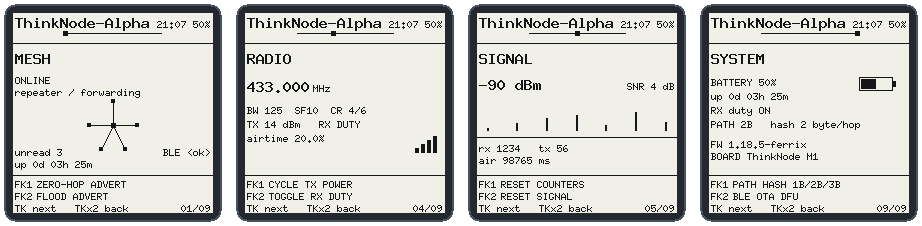
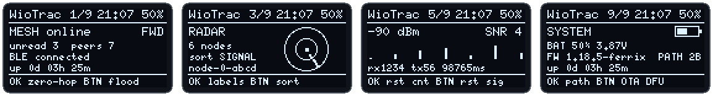

# FerrixCore

**Drop-in Rust firmware for MeshCore v1.18 companion nodes** — with a crisp on-device dashboard, hardened SX1262 radio handling, and static zero-heap reliability on [Embassy](https://embassy.dev/).

[](https://github.com/navmad/FerrixCore/releases/latest)
[](https://github.com/navmad/FerrixCore/actions/workflows/conformance.yml)

[](LICENSE)

[Quick Flash](#quick-flash) · [On-Device Dashboard](#on-device-dashboard) · [Why Ferrix?](#why-flash-ferrix) · [Full Feature & CLI Guide](FEATURES.md) · [Build from Source](#development)

---

## On-Device Dashboard

Ferrix turns your node's display into a live mesh instrument — check signal health, browse nearby nodes on a radar, read messages, toggle TX power / RX duty-cycle / GPS, switch 1B/2B/3B path hashing, or launch BLE OTA DFU without pulling out your phone.

**Elecrow ThinkNode M1** *(1.54" 200×200 e-paper — anti-ghosting refresh, frontlight wake, 2-button navigation)*



**Seeed Wio Tracker L1 Pro** *(1.3" 128×64 OLED — 30 s idle sleep, wake on message, 5-way joystick)*



Built-in views across both boards: **Mesh Status**, **Inbox**, **Node Radar**, **Radio**, **Signal History**, **Position / GPS**, **Client Repeat**, **Settings** (LEDs & buzzer), and **System** (battery, RX duty, path hash, BLE OTA DFU).

---

## Why Flash Ferrix?

Works out of the box with existing **MeshCore v1.18 companion apps** (iOS, Android, Web, and CLI) over BLE and USB — while adding RF, power, and reliability upgrades under the hood:

| Feature | What it means in practice |
| :--- | :--- |
| **Drop-in Companion Compatibility** | Reports standard `MeshCore` USB/protocol identifiers and `<version>-ferrix` (e.g. `1.18.5-ferrix`) so your existing MeshCore v1.18 apps connect without changes. |
| **Rich On-Device UI** | Read inbox messages, view neighbor radar and RSSI/SNR history, adjust TX power / RX duty / GPS / path hash, and start BLE OTA right from the board controls. |
| **Auto Stuck-AGC Recovery** | Detects a deaf/locked SX1262 receiver and automatically recalibrates and re-arms RX without rebooting — plus live 5 s RF noise-floor sampling. |
| **3-Lane TX Scheduler + Hardware CAD** | Separates **Control** (DMs/ACKs), **Flood**, and **Background** (adverts) with a protected 25% control reserve, 4-symbol starvation-gated LBT/CAD, and over-the-air duplicate cancellation. |
| **RX Duty-Cycle Sniff Mode** | Optional `set rxduty on` (or right from the Radio page) saves battery on SF7–SF12 with an inactivity watchdog. |
| **Optional Offline Message Persistence** | Keep unread inbox messages in RAM by default to avoid routine flash wear, or enable `set msg.persist on` so unread messages survive reboots — skipping flash writes whenever BLE is connected and reconciling on disconnect or clean reboot. |
| **Zero-Heap Rust & Flash Longevity** | Static `no_std` Rust with build-time task-arena verification and wear-leveled `sequential-storage` that writes config and contacts only on actual changes. |
| **Deep Diagnostics** | 10 compact JSON `stats-*` commands over USB or app CLI (`stats-tx`, `stats-agc`, `stats-flash`, `stats-ble`, `stats-gps`, `stats-power`, `stats-wdt`, plus standard stats). |

For the full comparison vs. stock MeshCore, every CLI command, and current limitations, see [FEATURES.md](FEATURES.md).

---

## Supported Boards

| Board | Display | Prebuilt Releases | Board Docs & Pinout |
| :--- | :--- | :--- | :--- |
| **Elecrow ThinkNode M1** | 1.54" SSD1681 e-paper | [`ferrix-thinknode-m1-companion-*.{uf2,zip}`](https://github.com/navmad/FerrixCore/releases/latest) | [boards/thinknode-m1/README.md](boards/thinknode-m1/README.md) |
| **Seeed Wio Tracker L1 Pro** | 1.3" SH1106 OLED | [`ferrix-wio-tracker-l1-pro-companion-*.{uf2,zip}`](https://github.com/navmad/FerrixCore/releases/latest) | [boards/wio-tracker-l1-pro/README.md](boards/wio-tracker-l1-pro/README.md) |

*(Companion role + off-grid client repeat on allowed frequencies. Standalone repeater, room server, and sensor roles are not yet implemented.)*

---

## Quick Flash

> [!WARNING]
> **First-time switch from stock MeshCore requires a full flash erase.**
> Ferrix uses wear-leveled `sequential-storage` across internal flash and external QSPI flash instead of stock MeshCore's LittleFS layout. Back up your private key (`get prv.key`) and contacts, then run a full flash erase (e.g., via the MeshCore web flasher's erase option or an erase UF2) before flashing Ferrix for the first time — and again if you ever switch back to stock MeshCore.
>
> **Upgrading between Ferrix releases preserves your identity, settings, and contacts.**

### UF2 Drag-and-Drop (Easiest)

1. Download the latest `.uf2` for your board from **[GitHub Releases](https://github.com/navmad/FerrixCore/releases/latest)**.
2. Connect your board over USB-C and **double-click the reset button** to mount the `NRF52BOOT` / `THINKNODE` drive.
3. Drag the `.uf2` file onto the drive — the board reboots into Ferrix automatically.

### Serial DFU & BLE OTA

Prebuilt `.zip` packages are also attached to every release for `adafruit-nrfutil` serial DFU and wireless BLE OTA DFU (requires an OTAFIX-compatible bootloader; trigger via `start ota` or the System page). Full flashing instructions, pinouts, and memory maps live in each board's README:

- [Elecrow ThinkNode M1 flashing guide](boards/thinknode-m1/README.md#flashing)
- [Seeed Wio Tracker L1 Pro flashing guide](boards/wio-tracker-l1-pro/README.md#flashing)

---

## Development

### Prerequisites

- **Rust toolchain** with the Cortex-M4F target and LLVM tools (for `llvm-objcopy`):
  ```bash
  rustup target add thumbv7em-none-eabihf
  rustup component add llvm-tools-preview
  ```
- **For serial / BLE OTA DFU packaging**: [`adafruit-nrfutil`](https://github.com/adafruit/Adafruit_nRF52_nrfutil) (`uv tool install adafruit-nrfutil` or `pipx install adafruit-nrfutil`).
- **For SWD debugging (optional)**: [`probe-rs`](https://probe.rs/).

### Build & Test

Because `.cargo/config.toml` defaults to `thumbv7em-none-eabihf`, use `./tools/build.sh` so host unit tests and embedded builds target the right architecture (firmware builds automatically run `tools/check_task_arena.py` to verify all Embassy tasks fit inside the static task arena):

```bash
# Release build (default external QSPI + internal flash storage profile)
./tools/build.sh thinknode-m1 build --release
./tools/build.sh wio-tracker-l1-pro build --release

# Release build keeping all stores in internal flash (no QSPI)
./tools/build.sh thinknode-m1 build --release --features internal-storage

# Run all host unit tests (wire codecs, storage, routing, mesh sim,
# scheduler, board logic & golden UI snapshots, arena checker self-test)
./tools/build.sh test

# Hardware-in-the-loop smoke test against a connected board over USB
./tools/build.sh thinknode-m1 hil
./tools/build.sh wio-tracker-l1-pro hil
```

> [!NOTE]
> Check or build workspace targets with `cargo check` from the root (defaults to `firmware/thinknode-m1-companion` for `thumbv7em-none-eabihf`). Avoid bare `cargo test` without `--target <host-triple>`, as embedded crates do not link `std` or `test`.

<details>
<summary><strong>Workspace Architecture & Adding a New Board</strong></summary>

```text
FerrixCore/
├── firmware/
│   ├── thinknode-m1-companion/  # Binary crate (`ferrix`): binds board + role
│   └── wio-tracker-l1-pro-companion/
├── roles/
│   ├── companion/               # Companion role: identity, transports, app loop
│   └── repeater/                # Repeater role (placeholder, not built yet)
├── boards/
│   ├── thinknode-m1/            # ThinkNode M1 BSP: pins, display UI, storage regions, memory.x
│   │   └── logic/               # Host-testable UI, input, layout, and radio mapping (`ferrix-thinknode-m1-logic`)
│   └── wio-tracker-l1-pro/      # Wio Tracker L1 Pro BSP: pins, OLED UI, joystick, memory.x
│       └── logic/               # Host-testable UI, input, layout, and radio mapping (`ferrix-wio-tracker-l1-pro-logic`)
├── platforms/
│   └── nrf52/                   # nRF52840 support: SoftDevice BLE, USB CDC, QSPI, flash, WDT,
│                                #   shared storage/GNSS/battery/host glue
├── drivers/
│   ├── radio/sx1262/            # Semtech SX1262 driver (`ferrix-sx1262`)
│   ├── display/ssd1681/         # SSD1681 e-paper driver (`ferrix-ssd1681`)
│   ├── display/sh1106/          # SH1106 OLED driver (`ferrix-sh1106`)
│   └── gnss/l76k/               # Quectel L76K NMEA driver (`ferrix-l76k`)
├── crates/
│   ├── meshcore-wire/           # Pure `no_std` MeshCore packet/frame codecs
│   ├── ferrix-hal/              # Platform-agnostic hardware traits and LoRa airtime math
│   ├── ferrix-core/             # Protocol handlers, routing engine, state, storage formats, mesh sim
│   └── ferrix-runtime/          # Role-agnostic async app, radio, and storage event loops
├── vendor/                      # Local patches (`nrf-softdevice`, `lora-phy`, `sequential-storage`)
└── tools/                       # Build, UF2/OTA/serial DFU scripts, arena check, HIL smoke tests, CLI monitor, oracle
```

#### Adding a New Board

1. Create a library crate under `boards/<name>/` (plus a host-testable `boards/<name>/logic/` crate) containing its `memory.x`, pinout, display/UI bindings, storage layout, and a `README.md` documenting specs, pinout, and flashing.
2. Implement the role trait from `roles/<role>/` (e.g., `CompanionBoard`) and the `ferrix-runtime` board traits.
3. Add a binary crate under `firmware/<board>-<role>/` that selects the board and role.
4. Register the crates in the root `Cargo.toml` workspace, `tools/build.sh` / `tools/build_uf2.sh` / `tools/build_ota.sh` / `tools/flash_serial.sh`, and `.github/workflows/conformance.yml` / `.github/workflows/release.yml`.

</details>

<details>
<summary><strong>Tooling Reference (<code>tools/</code>)</strong></summary>

- `tools/build.sh` — Unified wrapper for board builds (with Embassy task arena verification), `probe-rs` runs, host-target unit tests (`./tools/build.sh test`), and HIL smoke tests (`./tools/build.sh <board> hil`).
- `tools/build_uf2.sh` & `tools/uf2conv.py` — ELF-to-UF2 packaging for bootloader drag-and-drop flashing.
- `tools/build_ota.sh` — Builds and packages a Nordic/Adafruit DFU `.zip` for BLE OTA (nRF Device Firmware Update / OTAFIX bootloader) or web/serial flashing.
- `tools/flash_serial.sh` — End-to-end 1200-baud DFU reset, zip creation, and `adafruit-nrfutil` serial flash.
- `tools/check_task_arena.py` — Inspects DWARF info in the compiled ELF to ensure all Embassy `TaskPool` allocations fit in the static task arena before flashing or releasing.
- `tools/hil/` — Hardware-in-the-loop USB smoke tests (`nrf52_smoke.py`, `thinknode_smoke.py`, `wio_smoke.py`) verifying clocks, regulators, QSPI, GPS, battery, companion framing, and reboot persistence.
- `tools/cli_monitor.py` — Interactive USB serial monitor for the Ferrix text CLI.
- `tools/oracle/` — Python reference/vector generator (`gen.py`, `selfcheck.py`) used to validate `meshcore-wire` packet and crypto codecs.

</details>

---

> **Note:** This project is developed with the assistance of AI coding tools. Licensed under the [MIT License](LICENSE).
